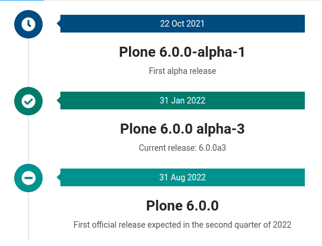
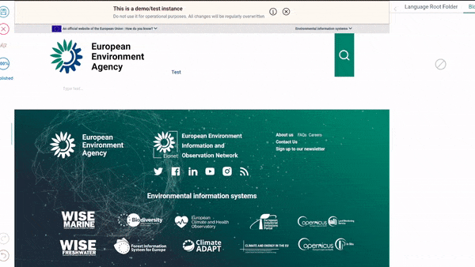

# @eeacms/volto-timeline-block

[](https://github.com/eea/volto-timeline-block/releases)
[](https://ci.eionet.europa.eu/view/Github/job/volto-addons/job/volto-timeline-block/job/master/display/redirect)
[](https://sonarqube.eea.europa.eu/dashboard?id=volto-timeline-block)

[Volto](https://github.com/plone/volto) add-on: [Timeline block](https://eea.github.io/volto-kitkat-frontend/?path=/story/components-timeline--multiple-reversed)

## Features




## Requirements

### Backend

- [Plone](https://plone.org/download)
- [plone.restapi](https://pypi.org/project/plone.restapi/)

### Frontend

- Node.js: `>=22.0.0`

## Installation

1. Make sure you have a [Plone backend](https://plone.org/download) up-and-running at http://localhost:8080/Plone

   ```Bash
   docker compose up backend
   ```

1. Start Volto frontend

* If you already have a volto project, just update `package.json`:

   ```JSON
   "dependencies": {
       "@eeacms/volto-timeline-block": "*"
   }
   ```

   and `volto.config.js`:

   ```JavaScript
   const addons = ['@eeacms/volto-timeline-block'];
   ```

* If not, create one with Cookieplone, as recommended by the official Plone documentation for Volto 18+:

   ```
   uvx cookieplone project
   cd project-title
   ```

1. Install or update dependencies, then start the project:

   ```
   make install
   ```

   For a Cookieplone project, start the backend and frontend in separate terminals:

   ```
   make backend-start
   make frontend-start
   ```

1. Go to http://localhost:3000

1. Happy editing!

## License

See [LICENSE.md](LICENSE.md) for details.

## Funding

[European Environment Agency (EU)](http://eea.europa.eu)
